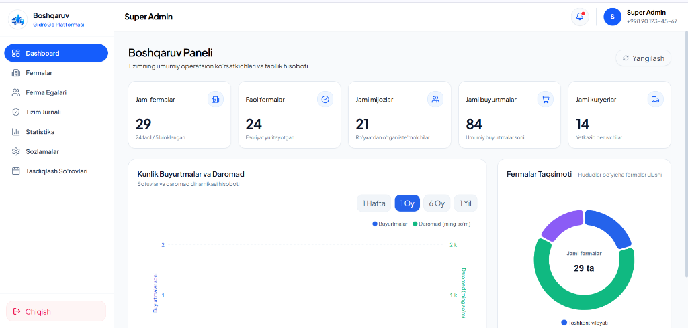
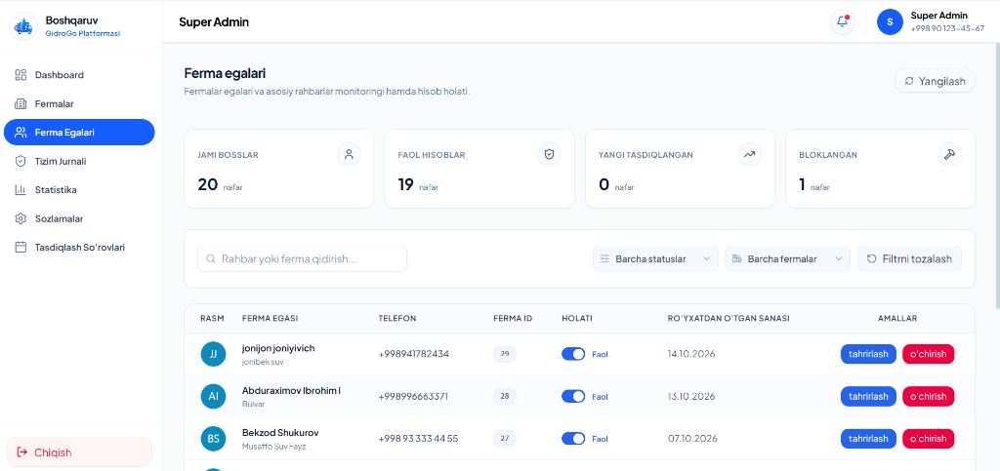
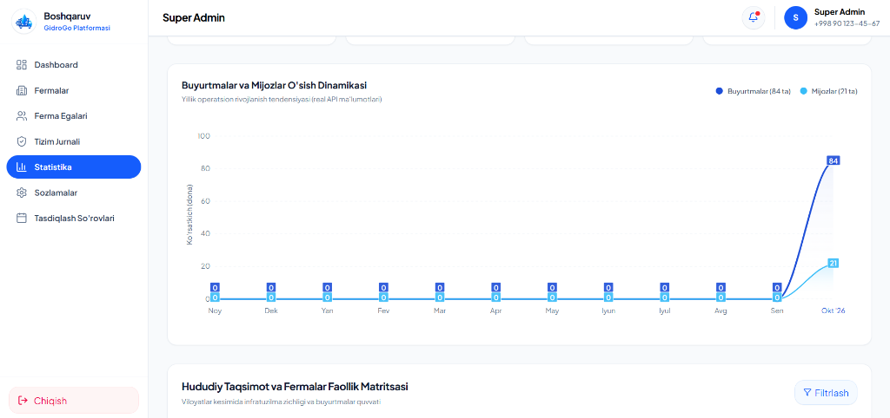

# GidroGo — Multi-Farm Water Delivery & Operations Management Platform

[](https://gidrogo-project.vercel.app)
[](https://react.dev/)
[](https://vitejs.dev/)
[](https://tailwindcss.com/)
[](LICENSE)

> **GidroGo** is a comprehensive, scalable enterprise ecosystem engineered to streamline and centralize water delivery logistics, distributed farm operations, customer order lifecycles, and staff workflows across regions.

🌐 **Live Production Panel:** [https://gidrogo-project.vercel.app](https://gidrogo-project.vercel.app)

---

## 📸 Platform Interface & Screenshots

### 1. Operations Dashboard
Real-time operational KPIs, high-level metrics (total/active farms, total clients, orders, couriers), order dynamic trend lines, and regional farm distribution matrices.



---

### 2. Farm Owners & Management (Boss Directory)
Centralized supervision of registered farm owners, multi-state status controls (Active, Inactive, Blocked), assigned farm identification, and instant administrative actions.



---

### 3. Analytics & Growth Dynamics
Annual operating volume trends, daily dynamics (completed vs. cancelled orders), consumer adoption trajectories, and regional infrastructure density maps.



---

## ✨ Core Features & Capabilities

- **Multi-Tenant Administration:** Dedicated dashboards and scoped capabilities for SuperAdmins, Farm Owners (Bosses), Managers, and Couriers.
- **Real-Time Logistics & Dispatch:** End-to-end order orchestration from intake and bottle handover to courier delivery routing.
- **Financial & Volume Auditing:** Live tracking of daily revenues, tara/bottle balances, handover confirmation, and status changes.
- **System Audit Log & Security:** Immutable recording of SuperAdmin actions, entity modifications, status transitions, and role enforcement.
- **Mixed-Content & Secure Asset Handling:** Built-in sanitization pipeline with reverse proxy routing to ensure flawless media delivery under strict HTTPS environments.
- **Data Validation & Form Safety:** Strict runtime schema validations utilizing Zod and React Hook Form.

---

## 🛠 Tech Stack & Architecture

| Layer | Technologies |
| :--- | :--- |
| **Frontend Framework** | [React 19](https://react.dev/), JavaScript (ESNext) |
| **Build Tooling & Bundler** | [Vite 8.3](https://vitejs.dev/) (lightning-fast HMR and optimized minified chunks) |
| **Design System & UI** | [Tailwind CSS v4](https://tailwindcss.com/), [Mantine Core](https://mantine.dev/), [Lucide React](https://lucide.dev/) |
| **Server State & Caching** | [@tanstack/react-query](https://tanstack.com/query) v5 |
| **Interactive Visualizations** | [ApexCharts](https://apexcharts.com/) via `react-apexcharts` |
| **Form Management** | `react-hook-form`, `@hookform/resolvers`, [Zod](https://zod.dev/) |
| **HTTP Client & Proxy** | [Axios](https://axios-http.com/) with request/response interceptors & Vercel API rewrites |
| **Deployment Platform** | [Vercel](https://vercel.com/) |

---

## 🚀 Getting Started Locally

### Prerequisites
- [Node.js](https://nodejs.org/) (version `v18+` or higher recommended)
- `npm` or `pnpm` package manager

### Installation

1. **Clone the repository:**
   ```bash
   git clone https://github.com/jumaqulovyashnar/GidroGo-project.git
   cd GidroGo-project
   ```

2. **Install project dependencies:**
   ```bash
   npm install
   # or with pnpm:
   pnpm install
   ```

3. **Configure Environment Variables:**
   Duplicate the example environment file and adjust your variables:
   ```bash
   cp .env.example .env
   ```

4. **Run the Development Server:**
   ```bash
   npm run dev
   ```
   Open your browser and navigate to `http://localhost:5173`.

5. **Build for Production:**
   ```bash
   npm run build
   ```

---

## 🔒 Security & Privacy

- All sensitive credentials, API keys, and internal IP addresses are decoupled through environment-level variables and server-side reverse proxying.
- Strict `.gitignore` and `.dockerignore` policies prevent secret leakage across commits and image builds.

---

## 📄 License

This project is licensed under the Apache 2.0 License. See the [LICENSE](LICENSE) file for more information.
